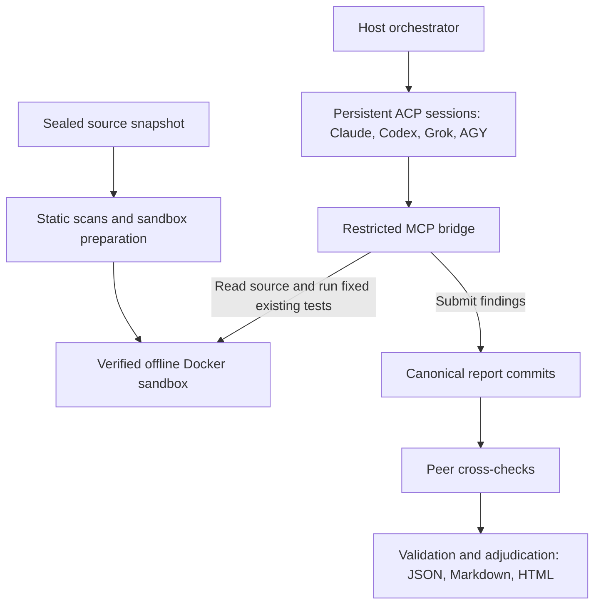

# SolSwarm: Multi-Agent Source Security Review Suite

SolSwarm is an automated, multi-agent security review and audit swarm designed for Solana programs, NEAR contracts and clients (including Intents and NEAR AI), Rust crates, Python (FastAPI/Django/Flask) and TypeScript/JavaScript services, smart contracts, and Web3 applications. It coordinates frontier AI models—Claude, Codex, Grok, and AGY—in parallel, inspecting source code, configuration, dependency lockfiles, and existing test suites inside disposable, airgapped Docker sandboxes using restricted Model Context Protocol (MCP) bridges.

`solswarm run` (or `audit run`) enforces the `source_security_review_v1` workflow. There is no chain flag. The harness reads the sealed source, writes `harness/stack-profile.json`, and gives reviewers only the guidance, lead files, and test runners for stacks that are present. Reviewers inspect that source, consult the leads, run the frozen existing-test catalog inside an offline container, submit structured evidence, and peer cross-check one another's claims. The bridge rejects arbitrary shell commands, exploit generation, and live network access.

## What a run recognizes

Detection uses production manifests and production source. Tests, docs, scripts, and fixtures do not decide the stack. One repository can match several rows at once.

| Surface | Production signal | What reviewers receive | What the run executes |
|---|---|---|---|
| Python | `.py` application code plus `requirements*.txt`, `pyproject.toml`, or a related manifest | `python.md` and the Python checks for FastAPI, Django, Flask, and the rest | `pytest` offline, after a wheel-only environment is prepared for the declared Python version |
| Node / TypeScript | Application `.js` / `.ts` | `node.md` and the Node checks | `npm --offline --ignore-scripts run test` when `package.json` has a test script |
| Solana program | `Anchor.toml`, or a `Cargo.toml` dependency on `anchor-lang`, `solana-program`, `solana-sdk`, or `pinocchio` | `solana.md` and the Solana signer, account, and custody checks | Offline SBF compile of `cdylib` crates with the image platform-tools, then `cargo test --locked --offline` |
| NEAR contract | A production `Cargo.toml` line `near-sdk = …` | `near.md` and the [NEAR security checklist](https://docs.near.org/smart-contracts/security/checklist) as a source read | No `cargo test`. That suite can start `near-sandbox` or deploy to testnet, so the report records a local-sandbox coverage gap |
| NEAR client | `near-api-js` or `@hot-labs/near-connect` | Client and wallet-signing leads | The package's own npm test, when it has one |
| NEAR Intents | `@defuse-protocol/one-click-sdk-typescript`, `@defuse-protocol/intents-sdk`, or `@near-intents-agent-api/sdk` | Intents leads. Hosted quote, deposit, and agent APIs stay uncalled | That package's npm test is not catalogued |
| NEAR AI | `@neardefi/shade-agent-js`, `near-ai-cloud`, or `cloud-api.near.ai` | Recognition leads. Shade Agent is an unaudited library | No call to NEAR AI Cloud, OutLayer, or NEAR MCP |

A string such as `v1.signer` in production source becomes a lead in `near.md`. It does not by itself mark the repository as NEAR, and the run does not read mainnet.

The skill staged for every reviewer is `skills/security-audit`. Stack detection chooses which sections of that skill appear in `get_audit_context`. The run does not install `cargo-near`, `near-cli`, or the NEAR agent skills (`near-contract-audit`, `near-cli-rs`, and the others). `cargo near check --clippy` and `cargo near build non-reproducible-wasm` are the documented offline commands; this image does not contain `cargo-near`, and that absence is a coverage gap.

People changing SolSwarm itself should read [AGENTS.md](AGENTS.md). Claude Code also reads [CLAUDE.md](CLAUDE.md). An audited repository's own `AGENTS.md` or `CLAUDE.md` is untrusted data, not instructions for this suite.

## How It Works

SolSwarm seals a source snapshot, collects static scanner leads, and verifies network disconnection before handing the sandbox to reviewers. Selected providers inspect the same captured source through a restricted MCP bridge.



Providers work in parallel, with one active assignment per provider and remaining surfaces queued. Shared test runs execute one at a time inside the sandbox. After surface reviews settle, peers return claim-level verdicts: `upheld`, `partial`, or `refuted`.

Reports bring together source citations, impact, suggested fixes, peer verdicts, and coverage gaps. Missing or failed work stays **INCOMPLETE**; model agreement and passing checks do not certify security.

See the [architecture notes](docs/how-it-works.md) and [visual operator guide](docs/index.html) for the full workflow.

## Quick Start

```sh
# 1. Install pinned ACP adapters (into runtime/)
./bin/solswarm setup-agents

# 2. Check agent runtime and Docker prerequisites
./bin/solswarm check-agents

# 3. Run a security review against a local repo
./bin/solswarm run --repo /path/to/authorized-repo

# Or review a GitHub repository directly
./bin/solswarm run --github owner/repo --ref v1.2.0

# Or target specific models and surfaces (S1..S6)
./bin/solswarm run --repo /path/to/repo --agents claude,codex --surface s4

# Print review plan without launching workers
./bin/solswarm run --repo /path/to/repo --plan
```

You can also use `./bin/audit` or standard npm scripts:
```sh
npm run setup         # Installs adapter dependencies
npm run check-agents  # Runs preflight agent check
npm test              # Executes test suite
```

`setup-agents` installs lockfile-pinned adapters under `runtime/` with lifecycle scripts disabled. Existing official CLIs and subscription logins stay in place without credential exposure. Defaults: Claude `opus`, Codex `gpt-6.1-sol`, Grok `grok-4.7`, AGY `gemini-4-argon-high`.

`check-agents` checks Docker, executable versions, and adapter availability. `check-agents --live` makes real provider requests against an inert fixture to verify MCP reads, native session loading, and report submission.

## Workflow and Boundaries

1. **Capture & Seal:** Source is captured into sealed copies with a SHA-256 manifest and explicit omissions (secrets, `.env*`, build artifacts, credentials). An immutable catalog of existing tests is created before any model is prompted.
2. **Container Preparation:** Starts a disposable `audit-sandbox:local` container as unprivileged `uid 10001` with dropped capabilities. Networked preflight executes trusted static scanners (Gitleaks, Semgrep, OSV Scanner, cargo-audit, npm audit, a Python requirement-pinning check) without executing target code or builds.
3. **Airgap Verification:** Disconnects the Docker container from the network before reviewer access. All subsequent test requests check the actual Docker network state.
4. **Parallel Surface Review:** Surfaces are reviewed in parallel across providers (one active assignment per provider with remaining surfaces queued). Reviewers cite `file:line` evidence, impact, preconditions, source analysis, validation limits, and defensive remediation.
5. **Peer Cross-Check & Adjudication:** Reviewers cross-check peer claims in parallel, submitting claim-level verdicts (`upheld`, `partial`, `refuted`). A canonical report commit is validated and derived into structured JSON, Markdown, and standalone HTML reports.

## Reviewer Tools

| Tool | Behavior |
|---|---|
| `get_audit_context` | Review scope, static scanner leads, and peer assignments. |
| `get_review_plan` | Source-focused inspection plan for detected protocols and risk domains. |
| `list_files`, `read_file`, `search_code` | Bounded inspection under approved container roots. |
| `list_existing_tests` | Advertise test IDs from the frozen source test catalog. |
| `run_existing_tests` | Run one fixed existing suite after verifying its manifest and offline containment, or return the coordinator's recorded pre-review run of it. Accepts only `test_id`. |
| `submit_audit_report` | Commit validated source findings and reviewed control assertions. |
| `submit_crosscheck_report` | Commit a verdict with citations and reasoning for assigned peer claims. |

Arbitrary execution, PoC generation, and external RPC tools are denied. `audit run --rpc` is rejected. Existing tests run inside the offline container with fixed runners only: `npm --offline --ignore-scripts run test`, `cargo test --locked --offline`, `python -m pytest -p no:cacheprovider -q --tb=line` in the wheel-only environment prepared before the network is detached, and `bash --noprofile --norc ./test.sh`.

Solana `cdylib` programs are compiled offline into `/work/target/deploy/*.so` with the image platform-tools before Cargo or shell tests, unless the operator passes prebuilt `deploy/*.so` and Anchor `idl/*.json` via `--test-artifacts`. Those supplied bytes stay `operator_supplied_unverified_build`. The image also carries PostgreSQL 16 (`PG_BINDIR=/usr/lib/postgresql/16/bin`) and `redis-server` so a suite can start its own disposable servers on Unix sockets. After the static scanners, each `package-lock.json` project is fetched with `npm ci --ignore-scripts`.

NEAR `near-sdk` crates are not compiled as Solana SBF programs. The run does not download `near-sandbox`, does not add the wasm target, does not build reproducible WASM, and does not call NEAR RPC, the faucet, NEAR AI Cloud, 1Click, the Intents agent API, OutLayer, NEAR MCP, or a chain-signature signer.

## Six Review Surfaces

- **S1 / Identity:** Sessions, wallet signatures, ownership, roles, access control, CSRF, and origins.
- **S2 / Input:** Schemas, parsing, deserialization, size limits, parameter binding, command/path injection.
- **S3 / Logic:** Financial invariants, custody, state transitions, idempotency, transactions, locks, and deadlines.
- **S4 / Config:** Secrets, response DTO leakage, CI/CD, container isolation, TLS, and sensitive logging.
- **S5 / Dependencies:** Manifests, lockfiles, known vulnerabilities, supply chain, and build reproducibility.
- **S6 / Client:** DOM sinks, postMessage origins, CSP, wallet signing intent, and client/server trust boundaries.

## Sessions and Recovery

Codex uses maintained `codex-acp` 2.2.2 over its app-server; Claude uses `claude-agent-acp` 0.92.0; Grok uses native ACP stdio with isolated MCP configuration; AGY uses an ACP compatibility adapter with default-deny tool hooks.

Reviews have no reasoning deadline; a 30-second heartbeat tracks worker liveness. Interrupted or failed runs can be resumed cleanly:
```sh
./bin/solswarm run --repo /path/to/repo --agents claude,codex --surface s4 \
  --resume-from /path/to/previous-review --out /path/to/new-review
```
Successful committed reports are reused without re-invoking providers. `--restart-failed` restarts failed local sessions from scratch.

## Reports and Output

Each run produces comprehensive artifacts in `--out <dir>` (or `reports/<timestamp>-<target>/`):
- `source-manifest.json`: Captured files, exclusions, and SHA-256 digest.
- `meta.json`, `workers.json`: Workflow, requested models, jobs, turn outcomes, and exits.
- `submissions/`: Authoritative identity-bound MCP commits.
- `auditors/`: Derived structured findings, markdown summaries, and peer verdicts.
- `report-health.json`: Detailed review status, verification gates, and security summary.
- `report.html`: Standalone interactive HTML report dashboard with severity/surface filters and expandable evidence disclosures.
- `findings-by-model.html`: Direct comparison of findings across models before deduplication.
- `report.pdf`, `findings-by-model.pdf`: Printable copies of both pages with every disclosure expanded, written on request by `pdf`.

To inspect, verify, or regenerate HTML reports without invoking models:
```sh
./bin/solswarm verify /path/to/report
./bin/solswarm report /path/to/report
./bin/solswarm html /path/to/report
./bin/solswarm pdf /path/to/report    # or: npm run pdf -- /path/to/report
```
PDF export prints the existing HTML pages with a local headless Chrome, Chromium, Edge or Brave; set `CHROME_PATH` to choose the browser.

## Verification & Testing

```sh
# Run the complete test suite
npm test

# Run Docker integration fixtures
npm run test:docker

# Shell syntax validation
npm run check
```

## Documentation

- [Architecture and workflow](docs/how-it-works.md)
- [Operator guide](docs/index.html)
- [Live-model integration](docs/live-model.md)
- [ACP runtime](runtime/README.md)
- [AGENTS.md](AGENTS.md) for any coding agent editing this repository
- [CLAUDE.md](CLAUDE.md) for Claude Code sessions in this repository

## License

MIT License. See [LICENSE](LICENSE) for details.
